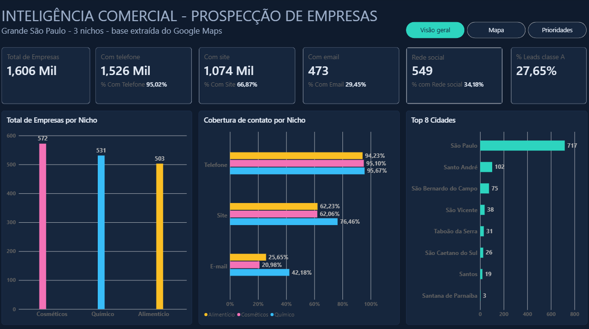
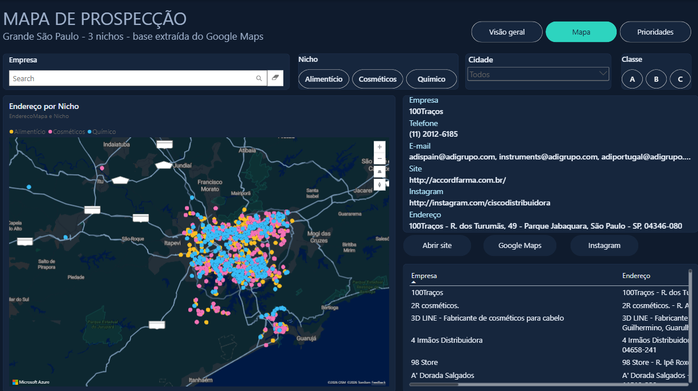
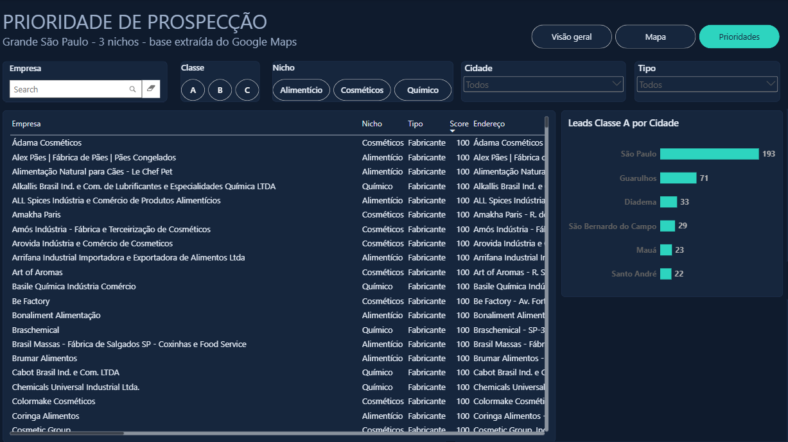

# Inteligência Comercial — Prospecção e Análise de Empresas

## Sobre o projeto

Projeto desenvolvido para apoiar a área comercial na identificação, organização e consulta de potenciais clientes.

A iniciativa envolveu a coleta de informações empresariais, consolidação de diferentes segmentos e desenvolvimento de um dashboard interativo para facilitar a análise e a consulta dos dados.

## Objetivos

- Organizar informações de potenciais clientes em uma base estruturada.
- Consolidar empresas de diferentes segmentos.
- Analisar a disponibilidade de informações de contato.
- Facilitar a consulta de empresas pela equipe comercial.
- Disponibilizar indicadores para exploração dos dados.

## Segmentos analisados

- Cosméticos;
- Indústrias químicas;
- Indústrias alimentícias.

## Tecnologias utilizadas

- **Google Maps Scraper Kit:** coleta de informações empresariais.
- **Docker:** execução do ambiente de coleta.
- **Excel:** organização e armazenamento das bases.
- **Power Query:** consolidação e preparação dos dados.
- **Power BI:** desenvolvimento do dashboard.
- **DAX:** criação de medidas e indicadores.

## Dashboard

O projeto conta com três páginas principais:

### 1. Visão Geral
- Total de empresas pesquisadas.
- Disponibilidade de telefone, e-mail e website.
- Presença digital.
- Comparação entre segmentos.
- Cobertura de contato por nicho.
  
  

### 2. Mapa
- Distribuição geográfica das empresas.
- Filtros por segmento.
- Consulta individual de empresas.
- Pesquisa por nome.
- Acesso aos contatos e canais digitais disponíveis.

  

### 3. Prioridades
Página destinada à exploração das informações e indicadores de apoio à equipe comercial, conforme os critérios definidos para o projeto. Com maior detalhamento de informações de cada empresa.

## Resultados

- Consolidação de aproximadamente 1.600 empresas.
- Organização de informações de três segmentos econômicos.
- Desenvolvimento de dashboard interativo para consulta e análise.
- Disponibilização de uma ferramenta de apoio às atividades de prospecção comercial.

---

## Autor

**José Rafael Santos Pereira**

Analista de Dados | Business Intelligence | Power BI | Docker | Excel | IA | Google maps scraper kit

LinkedIn: https://www.linkedin.com/in/rafaelsantospereirarsp/

GitHub: https://github.com/ZeRafaSp/

